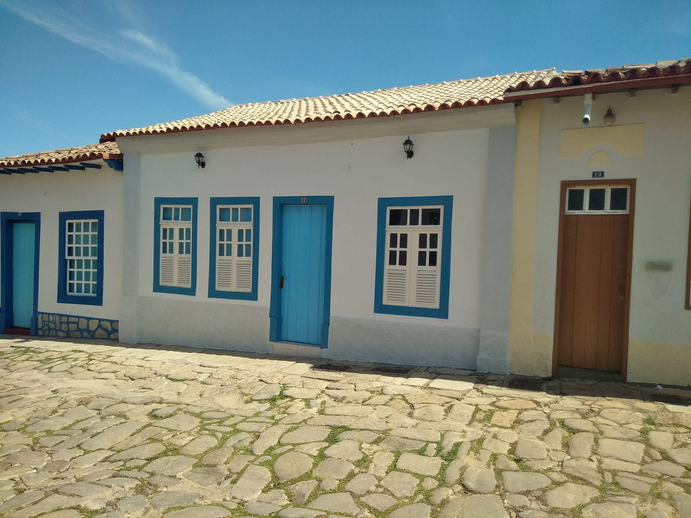
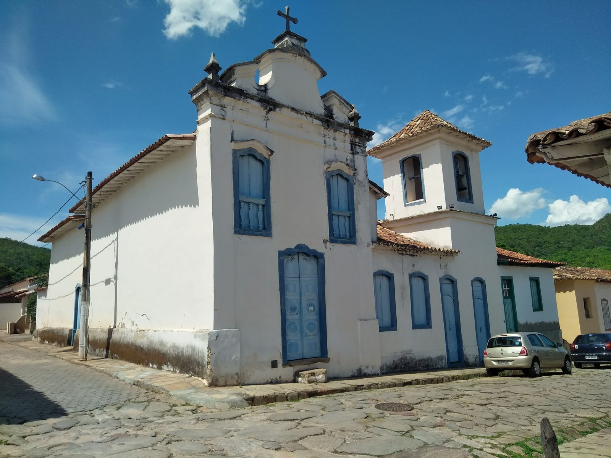
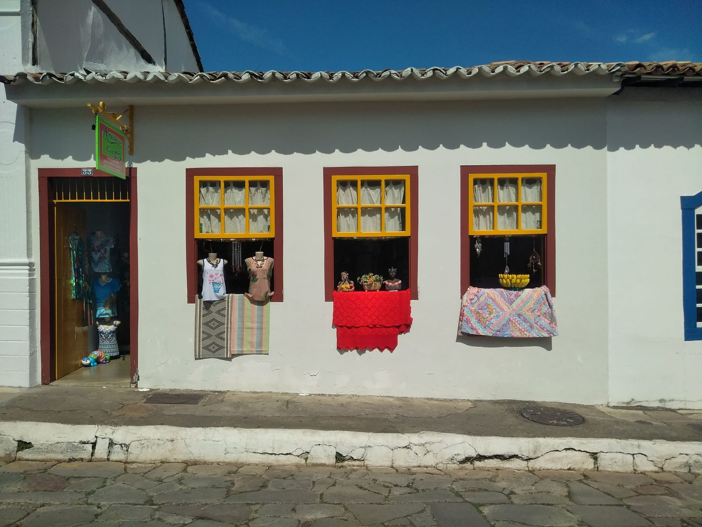
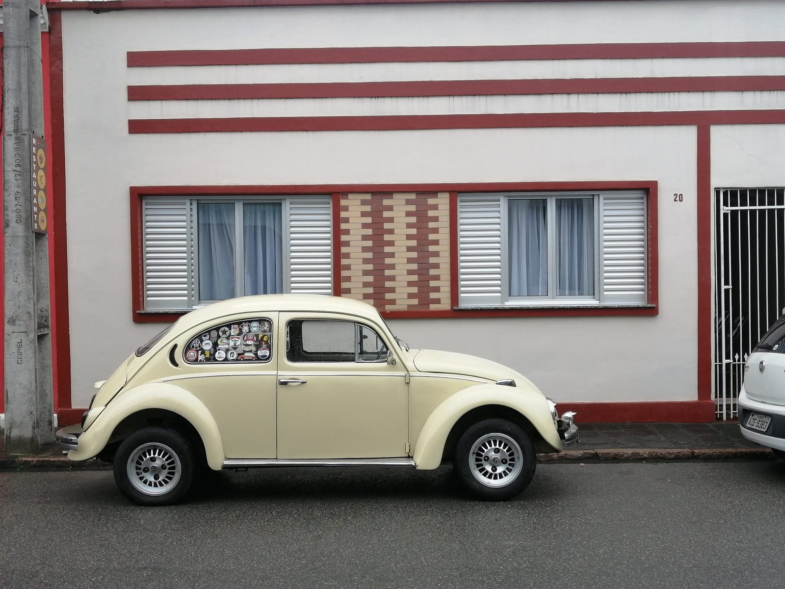

I went to Brazil for the first time in October 2018. Differently from the usual touristic routes (Rio de Janeiro and São Paulo), I went to visit Brasilia and Goias. The former is the capital of Brazil located in the district of Brasilia and the latter is an important state located in the center of the nation. From the beginning, I had the privilege to enjoy the richness and variety of this country in terms of nature and society. If you are interested in the dimension of Brazil compared to Europe, you can have a look at a [Peters World Map](https://en.wikipedia.org/wiki/Gall%E2%80%93Peters_projection).

Below you can see some of the images I took in the city of Goiás (also known as Góias Velho) which is a brazilian municipality classified as UNESCO World Heritage and ancient capital of the homonym state. 

<div style="text-align: center">


<p style="text-align:center;"> A typical house.</p>
</div>

<div style="text-align: center">


<p style="text-align:center;">A church.</p>
</div>

<div style="text-align: center">


<p style="text-align:center;">A clothes shop</p>
</div>

The city is also famous as the birthplace of Cora Coralina, the best-known Brazilian poetess. One of her famous poems, **Assim eu vejo a vida**:


<div style="text-align: center; font-style: italic;">
A vida tem duas faces:<br>
Positiva e negativa<br>
O passado foi duro<br>
mas deixou o seu legado<br>
Saber viver é a grande sabedoria<br>
Que eu possa dignificar<br>
Minha condição de mulher,<br>
Aceitar suas limitações<br>
E me fazer pedra de segurança<br>
dos valores que vão desmoronando.<br>
Nasci em tempos rudes<br>
Aceitei contradições<br>
lutas e pedras<br>
como lições de vida<br>
e delas me sirvo<br>
Aprendi a viver.
</div>
                           
                           
For my second trip in Brazil, I went to the south in the state of Paranà (the one with the highest Human Development Index). The beautiful image below is a Volkswagen Beetle which we can still see in the streets of Morretes, which is a small historic city of the Brazilian state of Paraná.                           

<div style="text-align: center">



</div>

For a complete reflection of my trip in Brazil, currently in italian, you can have a look at the file below. 

<div class="contributor_org">
`r xfun::embed_file(here::here("brazil", "Riflessione_sul_Brasile.pdf"), text = "Download pdf here")`
</div>

```{r eval=FALSE, include=FALSE, layout="l-body-outset"}
library(rmarkdown)
paged_table(mtcars)
```


