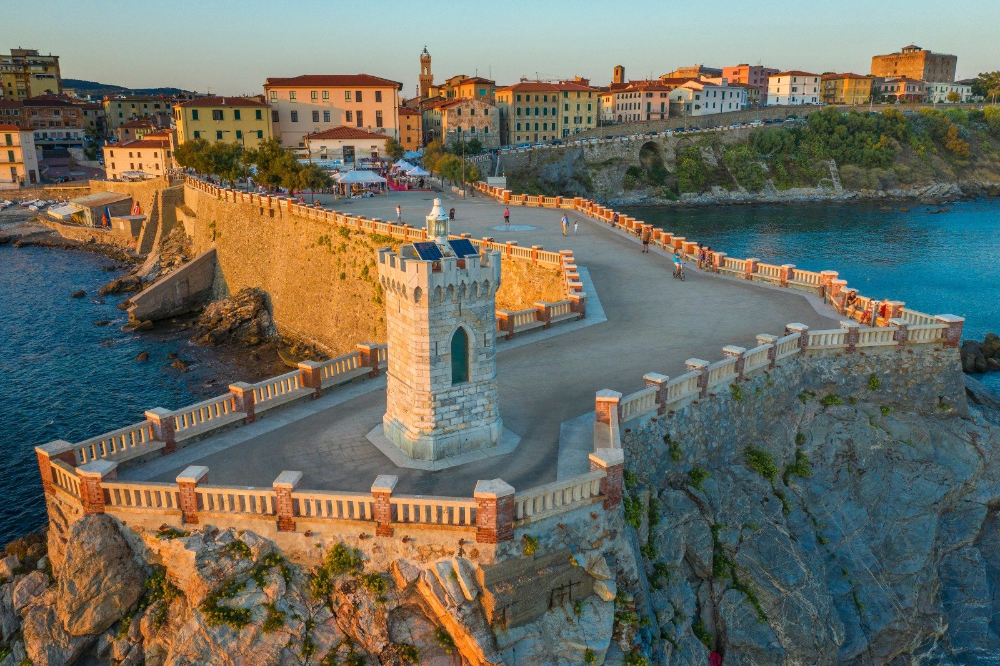

  
 Piazza Bovio, il faro.
 

Per gran parte del Novecento Piombino è stata soprattutto una cosa: l'acciaio. Altoforni, laminatoi, il porto per l'Elba. Il turismo c'era, ma stava ai margini, schiacciato tra la fabbrica e i traghetti. Negli ultimi vent'anni qualcosa è cambiato, e i dati della Regione Toscana permettono di vederlo con precisione.

<b>1,01 milioni</b>notti di turisti nel 2025, 10° comune toscano

<b>+15%</b>notti rispetto al 2019, prima della pandemia

<b>13.145</b>posti letto, il doppio del 2005

## Chi arriva

Nel 2025 sono arrivati 167.342 ospiti, che si sono fermati in media sei notti: un soggiorno lungo, da vacanza vera, molto più dei due-tre giorni tipici delle città d'arte. È un turismo soprattutto italiano. Gli stranieri valgono il 18% delle notti, contro il 43% del resto della Costa degli Etruschi.

La prima provenienza è la Toscana stessa, con mezzo milione di notti: è il mare di chi abita a Firenze, Pisa, Siena. Poi vengono Lombardia, Germania, Svizzera e Piemonte. Tra gli stranieri pesano soprattutto tedeschi e svizzeri, mentre gli olandesi sono calati molto rispetto al 2012.

## Dove dorme

Più della metà dei posti letto è nei campeggi e nei villaggi turistici, che restano il cuore dell'ospitalità di Piombino. Ma la storia più sorprendente è un'altra: gli agriturismi. Nel 2005 offrivano circa 330 posti letto, oggi più di 2.100. Sono cresciuti di quasi sette volte e sono diventati il terzo tipo di struttura, dopo campeggi e alberghi a tre stelle. Nello stesso periodo gli alberghi di categoria alta sono diminuiti.

## Quando arriva

Il turismo di Piombino è concentratissimo. Due notti su tre si passano tra luglio e settembre. In un giorno medio d'estate ci sono quasi 23 turisti ogni 100 abitanti; tra gennaio e marzo meno di uno. Su un anno intero, ogni residente "ospita" circa 31 notti di turisti, due volte e mezzo la media toscana, ma meno dei vicini della costa: a San Vincenzo, Castagneto Carducci o Bibbona la pressione è molto più forte.

## Quanto lavoro dà

Nel 2023 alberghi, campeggi, ristoranti e bar davano lavoro a circa 1.250 persone, il 12% degli addetti delle imprese private del comune. L'industria resta il primo settore, con circa 2.800 addetti, ma la distanza si accorcia anno dopo anno. Ed è una stima per difetto: gli agriturismi sono contati nell'agricoltura, e una parte del commercio vive anch'essa dei turisti.

## Esplora tutti i comuni

Tutti questi numeri, e molti altri, sono in una dashboard interattiva costruita con i dati aperti e la banca dati turismo della Regione Toscana. Si può scegliere qualunque comune toscano e confrontarlo con il suo ambito turistico, la provincia o la regione: arrivi e notti dal 2012, provenienze per regione e paese, tipi di struttura dal 2005, stagionalità, pressione sui residenti e peso sul lavoro.

<a href="../../turismo/index.html">Apri la dashboard sul turismo in Toscana →</a>

Fonti: Regione Toscana, open data su [dati.toscana.it](https://dati.toscana.it) e [banca dati turismo](https://www.regione.toscana.it/statistiche/banca-dati-turismo); ISTAT, archivio ASIA delle unità locali.
