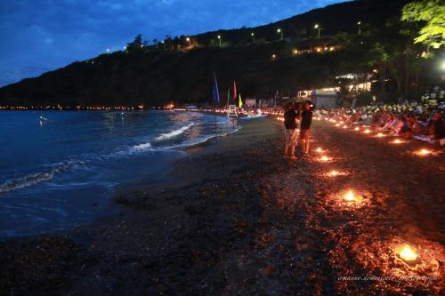
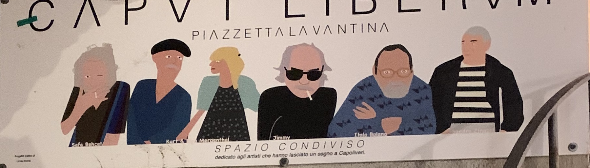

The small town of Capoliveri is perched on a hill 167 meters above sea level, on the slopes of Monte Calamita. In the past, it was tied to agricultural and mining activities, but today it is one of the most characteristic and lively centers on Elba Island, rich in charm and history.

Characterized by a very particular architecture, the town still retains the appearance of a medieval village with its narrow and picturesque arcaded alleys called "chiassi," which hide small artisan shops and charming eateries where you can enjoy a typical dish or a good glass of wine. There is indeed a restaurant called "Il chiasso" exactly because the tables to eat are in the small stairs of the alley. 

Curiosity: There have always been several hypotheses about the meaning of the name and the origins of the town. Caput Liberum, meaning "sacred to Liber," better known as Bacchus or Dionysus, might refer to a place rich in vineyards and excellent wine. Alternatively, it could more likely derive from the very shape of the section of the island where Capoliveri is located: free, as it is surrounded by the sea.

Capoliveri is divided into four distinct districts: Il Fosso, La Torre, La Fortezza, and Il Baluardo, which compete every October during the traditional Festa dell'Uva (Grape Festival), staging extraordinary choreographies on various harvest-related themes. 

The Festa dell'Uva is not the only cultural highlight in Capoliveri. On July 14, the Festa dell'Innamorata is celebrated, inspired by an ancient legend of two young lovers, Lorenzo and Maria. 

 Capoliveri, Spiaggia dell'innamorata Luglio 14.

This traditional celebration dates back to the second half of the 17th century when Don Domingo Cardenas 
A fallen nobleman of Spanish origin settled in Innamorata, then called Cala de lo Ferro, and recounted the events of an ancient legend passed down among the fishermen. It is the story of Lorenzo and Maria, two young lovers whose relationship was hindered by their families and social differences. The two lovers had made this corner of paradise, known as the Beach of the Innamorata, their love refuge. But one day, pirates captured Lorenzo and threw his body into the sea before Maria's eyes. Overcome with despair, Maria threw herself into the waters, vanishing forever into the depths of the sea, leaving behind only the shawl she had been wearing.

This symbolic celebration in Capoliveri and on the Island of Elba has grown in prominence over time, attracting attention from both national and international media.
Every year, the same magical ritual takes place: at 8:30 PM, a thousand candles are lit in the bay of Innamorata. At 9:15 PM, the bells of Capoliveri’s church announce the Historical Parade in period costumes, which begins in the town's historic center and proceeds on foot to the enchanting beach of Innamorata. "Maria," the girl from the legend who is said to have thrown herself into the sea to follow "Lorenzo," her beloved taken by the Saracens, dives from the Ciarpa rock into the sea, letting her white shawl (the Ciarpa) fall. Immediately afterward, the "Challenge of the Ciarpa" begins: four rowing boats, representing the four districts of Capoliveri's castle – the "Baluardo," the "Fosso," the "Torre," and the "Fortezza" – compete to capture the Ciarpa.

The entire coast is exceptionally beautiful, characterized by countless coves and small bays wrapped in the unmistakable beauty and scent of Mediterranean vegetation. Examples include the inlets of Morcone, Pareti, and Innamorata, once small fishing villages and now popular vacation spots, as well as the serene beaches of Naregno, Madonna delle Grazie, Felciaio, Norsi, or the larger and busier beaches of Lacona, Lido, and Margidore.

As small as it may seem, this town is perfect to stay in a quiet place, be creative and enjoy a peaceful mind. There is a special corner among the streets and glimpses of Capoliveri, an unexpected spot discovered by descending the ancient staircase behind the town square. It is the Borgo degli Artisti (Artists’ Village), where painters, sculptors, poets, and writers come together, bringing moments of art and culture to life in the historic center perched on the hills of the Calamita promontory. The Borgo degli Artisti, as named by its curator Michelangelo Venturini, has been welcoming artists—local and beyond—since May, and will continue to do so throughout the summer, giving a platform to expressiveness and creativity. Below an image referred to the artists in general:

 Caput Liberum, a creative spot.

Here is an Italian poem that Franco Marelli, an Italian writer, wrote for Capoliveri:

  

  Qui a Caput Liberum si ritrova la calma,  
  ed il senso delle cose piccole, eppure grandi:  
  un pasto condiviso,  
  una sera silenziosa,  
  un soffio gentile che sfiora il viso.  

  Prendilo, tienilo stretto,  
  questo alito lieve, flebile,  
  è ciò che ti resta  
  quando la tua terra si fa ricordo,  
  e il vento, lento, diventa sordo.  

  Mettilo all’orecchio,  
  non lasciarlo sfuggire,  
  sospiraci dentro, infondigli forza.  
  Poi trattienilo forte,  
  perché rimanga  
  sempre con te.
  

